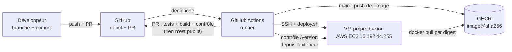
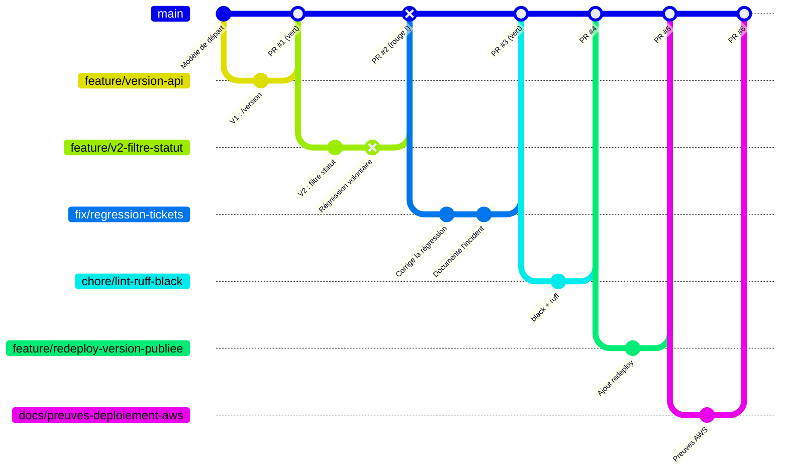
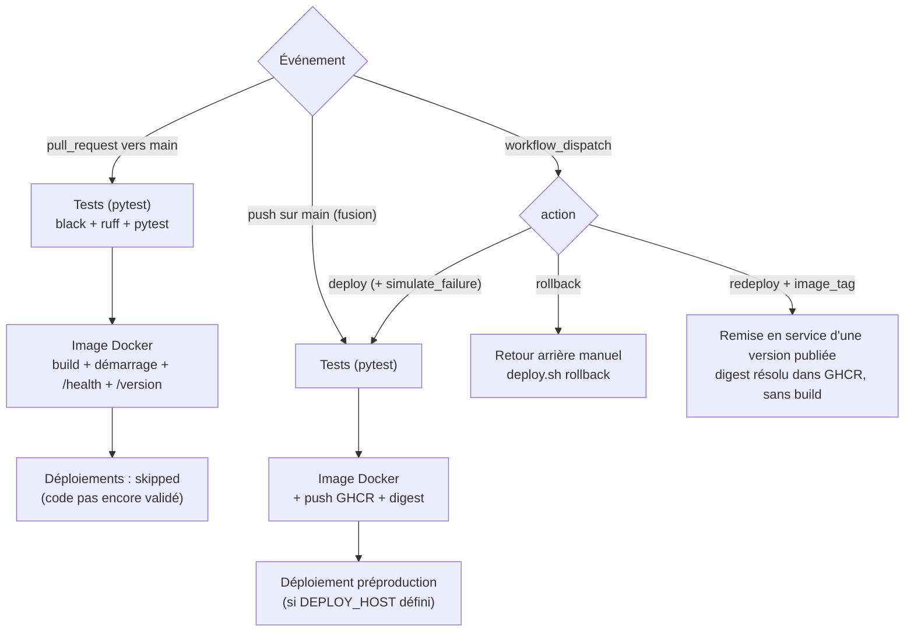
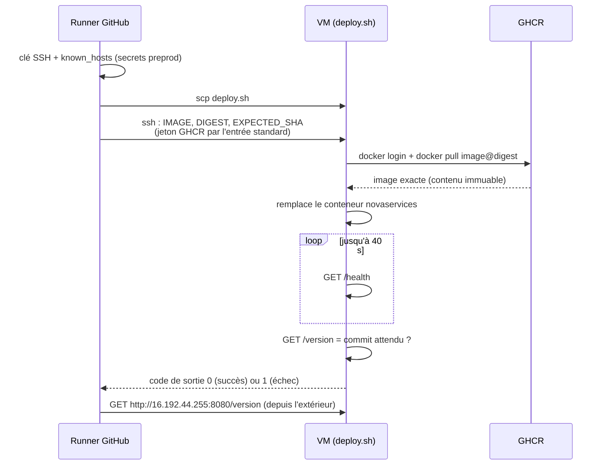
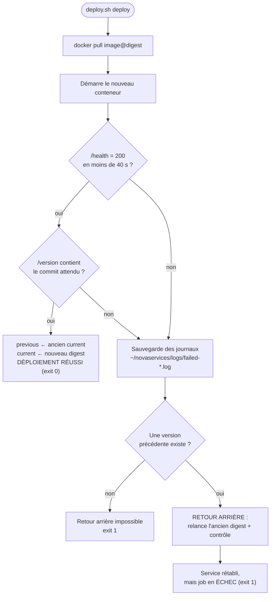
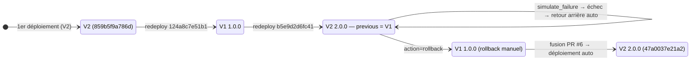

# Parcours d'un changement — support de l'oral (preuve 11)

Ce document explique la chaîne complète **commit → tests → image → GHCR (digest) → VM → contrôle →
retour arrière**, avec des schémas, le rôle de chaque fichier, un texte d'oral et les questions
probables. Les exemples renvoient à de vrais runs du dépôt (détails dans [`PREUVES.md`](PREUVES.md)).

---

## 1. Vue d'ensemble

| Composant | Rôle |
|---|---|
| **GitHub** | conserve le code, les PR, la protection de `main`, les variables et secrets |
| **GitHub Actions (runner)** | exécute les jobs : tests, construction, publication, déploiement |
| **GHCR** | registre d'images : conserve chaque image, identifiée par son digest |
| **VM de préproduction** | exécute l'application dans Docker, garde l'état `current` / `previous` |

---

## 2. Historique réel des branches

La PR #2 a été fusionnée **rouge** parce que `main` n'était pas encore protégée : c'est l'incident
documenté dans `PREUVES.md`. Chaque correction passe ensuite par une **nouvelle** branche et une
nouvelle PR.

---

## 3. Ce que fait le pipeline selon l'événement

| Événement | Ce qui tourne | Ce qui est publié / déployé |
|---|---|---|
| PR vers `main` | Tests, Image Docker | rien |
| Fusion (push sur `main`) | Tests, Image Docker, Déploiement | image sur GHCR + VM mise à jour |
| `action=deploy` | idem fusion (option `simulate_failure` : `/health` en 503) | idem |
| `action=rollback` | Retour arrière manuel | VM remise sur `previous` |
| `action=redeploy` | Remise en service d'une version publiée | VM sur le digest du tag demandé |

**Protection de `main`** : PR obligatoire, contrôles `Tests (pytest)` et `Image Docker` exigés sur une
branche à jour, pas de contournement (même admin), ni force push ni suppression. Un job *skipped*
ne bloque pas la fusion.

---

## 4. Déploiement : qui parle à qui

`StrictHostKeyChecking=yes` : le runner refuse de se connecter si l'empreinte de la VM ne correspond
pas à celle enregistrée (protection contre l'homme du milieu). L'empreinte a été lue dans le journal
de démarrage de l'instance via l'API AWS.

---

## 5. Logique de `deploy.sh` (contrôle et retour arrière)

---

## 6. Rôle de chaque fichier

### Application
| Fichier | Rôle |
|---|---|
| `app.py` | API Flask NovaServices : `/health` (503 si `SIMULATE_FAILURE=1`), `/version` (version + commit), `/tickets` (filtre `?status=` en V2), `/tickets/<id>`, 404 en JSON. Données fictives en mémoire. |
| `VERSION` | Numéro de version applicatif (`1.0.0` → `2.0.0`), lu par `app.py` et injecté dans l'image. |
| `requirements.txt` | Dépendances d'exécution à versions fixées : Flask, gunicorn. |
| `requirements-dev.txt` | Dépendances de développement : pytest, ruff, black (en plus des précédentes). |
| `pyproject.toml` | Configuration de black et de ruff (`select = ["ALL"]`, lignes de 100, Python 3.12, exceptions justifiées). |

### Tests
| Fichier | Rôle |
|---|---|
| `tests/conftest.py` | Fixture `client` : application de test avec une version et un commit connus, sans échec simulé. |
| `tests/test_app.py` | 7 tests de **comportement** : santé, liste des tickets (contrat « liste »), ticket unique et 404, route inconnue, `/version`, échec simulé (503), filtre V2. |
| `tests/__init__.py` | Fait de `tests/` un paquet Python. |

### Conteneur
| Fichier | Rôle |
|---|---|
| `Dockerfile` | Image `python:3.12-slim` : dépendances en couche cachée, code copié, `APP_VERSION` et `GIT_SHA` injectés (variables + labels OCI), utilisateur non root, gunicorn sur `0.0.0.0:8000`. |
| `.dockerignore` | Exclut du contexte de build ce qui n'a rien à faire dans l'image (`.git`, tests, docs…). |

### Pipeline et déploiement
| Fichier | Rôle |
|---|---|
| `.github/workflows/ci-cd.yml` | Pipeline : jobs *Tests*, *Image Docker* (build, contrôle, push GHCR + digest sur `main`), *Déploiement préproduction*, *Retour arrière manuel*, *Remise en service d'une version publiée*. |
| `deploy.sh` | Exécuté **sur la VM** : `pull` par digest, démarrage, contrôle `/health` + `/version`, retour arrière automatique, actions `deploy` / `rollback` / `status`, état dans `~/novaservices/current` et `previous`. |
| `.github/pull_request_template.md` | Modèle de description pré-rempli à chaque nouvelle PR. |

### Scripts d'administration
| Fichier | Rôle |
|---|---|
| `scripts/wait-for-http.sh` | Attend qu'une URL réponde 2xx (avec un motif attendu), avec une durée maximale ; utilisé par la CI. |
| `scripts/protect-main.sh` | Applique la protection de `main` par l'API GitHub (contrôles requis, PR obligatoire, pas de contournement). |
| `scripts/setup-github.sh` | Crée l'environnement `preprod`, les variables de la VM et les secrets (clé SSH, known_hosts après confirmation de l'empreinte). |

### Documentation et dépôt
| Fichier | Rôle |
|---|---|
| `README.md` | Guide pas à pas du TP, choix d'architecture, comportement du pipeline. |
| `docs/FICHE_CHOIX.md` | Fiche de choix : application, exécution, comportements validés, identification de version. |
| `docs/PREUVES.md` | Checklist des preuves avec liens vers les runs, incident de la PR #2, exécution réelle sur AWS. |
| `docs/ORAL_PARCOURS.md` | Ce document. |
| `docs/repetition/*.log` | Journaux de la répétition locale (V1, V2, échec simulé, retour arrière manuel). |
| `.gitignore` | Fichiers à ne jamais commiter (environnements virtuels, caches, clés…). |

### Configuration hors dépôt (jamais commitée)
| Élément | Où | Rôle |
|---|---|---|
| `DEPLOY_HOST`, `DEPLOY_USER`, `APP_PORT`, `DEPLOY_SSH_PORT` | variables du dépôt | adresse et accès de la VM ; `DEPLOY_HOST` vide = déploiement ignoré |
| `DEPLOY_SSH_KEY`, `DEPLOY_KNOWN_HOSTS` | secrets de l'environnement `preprod` | clé privée de déploiement et empreinte vérifiée de la VM |
| `GITHUB_TOKEN` | fourni par Actions à chaque run | push GHCR (CI) et `docker login` sur la VM |

---

## 7. Texte de l'oral (≈ 3 minutes)

1. **Le code part d'une branche, jamais de `main`.** Je crée une branche, je commite et j'ouvre une
   PR vers `main`. `main` est protégée : PR obligatoire, contrôles `Tests (pytest)` et `Image Docker`
   exigés sur une branche à jour, pas de contournement, même pour l'administrateur.

2. **Sur la PR, la CI vérifie mais ne livre rien.** *Tests* lance black, ruff et les 7 tests ;
   *Image Docker* construit l'image, la démarre et vérifie `/health` puis `/version`. Les jobs de
   déploiement sont *skipped*. Exemple : la régression de la PR #2 (`/tickets` renvoyait un objet au
   lieu d'une liste) a fait échouer `test_tickets_returns_list_of_tickets` → pipeline rouge.

3. **La protection rend le rouge bloquant.** La PR #2 a été fusionnée rouge car `main` n'était pas
   encore protégée. La chaîne s'est arrêtée (aucune image publiée, rien déployé) mais `main` était
   cassée. Correction par une nouvelle PR (#3), puis activation de la protection.

4. **À la fusion, l'image est publiée par son digest.** La CI rejoue les contrôles sur le commit
   fusionné, pousse l'image sur GHCR et relève son digest. Un tag peut bouger, un digest non : c'est
   l'image testée qui sera déployée, construite une seule fois.

5. **Déploiement.** Le runner se connecte en SSH à la VM AWS en vérifiant son empreinte, et lance
   `deploy.sh`, qui récupère `image@digest` et remplace le conteneur. Aucune reconstruction sur la VM.

6. **Contrôle et retour arrière.** `/health` doit répondre 200 en moins de 40 s, puis `/version` doit
   donner le commit attendu ; un dernier contrôle est fait depuis le runner. En cas d'échec, le script
   garde les journaux, relance la version précédente et **termine quand même en échec** : le service
   est rétabli mais l'incident reste visible. Démonstration : run 41644011581 (`simulate_failure`),
   503 pendant 40 s, retour automatique sur la V2 saine.

7. **Retour arrière manuel.** `action=rollback` remet le digest précédent : run 41644315825, retour à
   la V1 (`/version` → `1.0.0`).

**En une phrase :** GitHub conserve le code, la CI vérifie, GHCR conserve les images, la VM exécute, et
à chaque étape une preuve (tests, `/health`, `/version` = commit) décide si on avance ou si on revient.

---

## 8. Questions probables

- **Pourquoi un digest et pas `latest` ?** Un tag est modifiable, un digest est immuable : ce qui
  tourne est exactement ce qui a été testé, et le retour arrière est exact.
- **Pourquoi ne pas construire sur la VM ?** On exécuterait du code non testé, avec des dépendances
  peut-être différentes.
- **Pourquoi le job reste rouge après un retour arrière réussi ?** Pour ne pas masquer l'incident :
  la nouvelle version est cassée et doit être corrigée.
- **Pourquoi `/version` en plus de `/health` ?** `/health` dit « l'application vit », `/version` dit
  « c'est la bonne version ».
- **Que se passe-t-il sur une PR ?** Tests et build seulement ; rien n'est publié ni déployé.
- **Où sont les secrets ?** Dans l'environnement `preprod` de GitHub ; le jeton GHCR passe par l'entrée
  standard, jamais en argument ; rien n'est commité.
- **Pourquoi `action=redeploy` ?** La VM n'avait connu que la V2 : sans version précédente, le retour
  arrière manuel n'avait rien à restaurer. On a remis la V1 puis la V2 depuis GHCR, sans rebuild.
